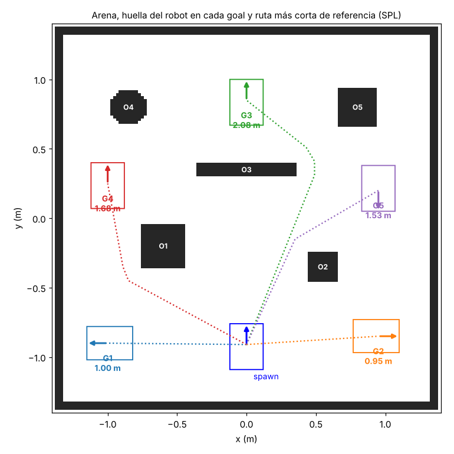

# X3 Plus Simulation — rama `Nav2`

Simulación del manipulador móvil omnidireccional **X3 Plus + Dofbot** en ROS 2 Jazzy y Gazebo Harmonic, con navegación autónoma (Nav2) en una arena de 2.7 × 2.7 m.

Esta rama contiene el experimento del **Artículo 1 (navegación y SLAM)**: N ≥ 20 corridas en Gazebo, cada una con 5 goal poses independientes, medidas con las métricas de la sección 6.

### Alcance y supuestos

- **Las métricas de navegación se obtienen solo en Gazebo.** Se descartó la comparación Gazebo vs MuJoCo para navegación por no ser realista ni práctica; las métricas de discrepancia entre simuladores (diferencia relativa y DTW) quedan fuera del alcance.
- **La cinemática del robot y los actuadores de las ruedas se consideran homologados** con el robot real. Esa homologación (modelo del motor, PID del firmware y sintonización) es el trabajo de la rama `Ruedas_mechanum` y aquí se toma como dada.
- **Los resultados se reportan con las ganancias del PID obtenidas por algoritmos genéticos** en la rama `Ruedas_mechanum`: Kp = 1.949, Ki = 0.256, Kd = 0.938. Son los valores por defecto de `mecanum_kinematic_node.py`, y además `waypoints_nav.py` las fija al arrancar y las registra en `results.json`.

### Estado de validación

| Parte | Estado |
|---|---|
| Cadena Gazebo + Nav2 con AMCL, verdad de terreno, colisiones (commit `1a41b8d`) | Validada en ejecución por el equipo |
| Ganancias del AG como valores por defecto | Hecho por el equipo |
| Nodos de cinemática y odometría dentro del launch de simulación | Hecho por el equipo |
| Nueva arena con 5 obstáculos, 5 goal poses, launch único con `localization:=amcl\|slam`, launch de slam_toolbox, métricas completas en `waypoints_nav.py` | **Revisado solo de forma estática** (sintaxis, y las métricas y gráficas probadas fuera de ROS con datos sintéticos). Falta la primera ejecución en ROS 2 / Gazebo: seguir la [sección 5](#5-verificación-de-la-primera-prueba) |

La descripción de los paquetes del robot (`omni_description`, `dofbot_description`, etc.) está en [`src/README.md`](src/README.md); partes de ese documento describen un estado anterior (Humble, error de `controller_manager`).

---

## 1. Arena y goal poses



**Obstáculos.** Cinco obstáculos estáticos de **0.25 m de alto**, por encima del haz del LiDAR (~0.19 m del piso), para que AMCL, los costmaps y SLAM los detecten. No hay pedestal ni objetos a manipular.

| Obstáculo | Forma | Centro (m) | Tamaño (m) |
|---|---|---|---|
| O1 | caja | (−0.60, −0.20) | 0.30 × 0.30 |
| O2 | caja | (0.55, −0.35) | 0.20 × 0.20 |
| O3 | muro | (0.00, 0.35) | 0.70 × 0.10 |
| O4 | cilindro | (−0.85, 0.80) | radio 0.12 |
| O5 | caja | (0.80, 0.80) | 0.25 × 0.25 |

**Goal poses.** Cada goal es un **episodio independiente** que arranca desde el spawn (0, −0.91, yaw π/2). La columna "ruta más corta" es la referencia del SPL.

| Goal | Pose (x, y, yaw) | Ruta más corta | Qué evalúa |
|---|---|---|---|
| G1 | (−1.00, −0.90, π) | 1.00 m | Trayecto recto; llegada cerca de dos paredes |
| G2 | (0.95, −0.85, 0) | 0.95 m | Trayecto corto por debajo de O2 |
| G3 | (0.00, 0.85, π/2) | 2.08 m | Oculto tras el muro O3: obliga a rodearlo |
| G4 | (−1.00, 0.25, π/2) | 1.68 m | Pasillo entre O1, O4 y la pared oeste |
| G5 | (0.95, 0.20, −π/2) | 1.53 m | Pasillo entre O2, O5 y la pared este; llegada mirando al sur |

**Dónde se define cada cosa:**

- `world/arena_world.world` es la **única fuente de la geometría**. `maps/generate_map.py` lee de ahí paredes y obstáculos y genera el mapa de referencia (`maps/arena_map.*`), alineado con el mundo.
- `config/goals.yaml` define el spawn, los 5 goals, la huella del robot y los modelos con sensor de contacto.
- Al arrancar, `waypoints_nav.py` **valida** cada goal: la huella del robot orientada en el goal debe quedar al menos a 5 cm de cualquier obstáculo, y debe existir ruta desde el spawn. Si un goal no cumple, el ejecutor se detiene con un error que lo indica.

Para cambiar la arena: edita el mundo, ejecuta `python3 src/omni_dofbot_bringup/maps/generate_map.py`, ajusta `goals.yaml` si hace falta y recompila.

---

## 2. Qué hay en la rama

Todo lo relevante está en `src/omni_dofbot_bringup`.

| Componente | Archivo | Función |
|---|---|---|
| **Launch único** | `launch/arena_nav.launch.py` | Simulación + control + Nav2 en una terminal; elige `localization:=amcl\|slam` |
| Simulación | `launch/omni_dofbot_controller.launch.py` | Gazebo, robot, controladores, puentes ROS–Gazebo, nodo cinemático, nodo de odometría y filtro del LiDAR |
| Control de ruedas | `src/mecanum_kinematic_node.py` | `/cmd_vel` → velocidad por rueda, con PID incremental a 100 Hz que imita el firmware |
| Odometría | `src/Mecanum_odometry_node.py` | Integra `/joint_states`; publica `/odom` y el TF `odom → base_footprint` |
| Filtro del LiDAR | `src/scan_self_filter.py` | Quita de `/scan` los rayos que golpean al propio robot y publica `/scan_filtered`, que consumen AMCL, costmaps, `collision_monitor` y slam_toolbox |
| Navegación | `launch/nav2_arena.launch.py`, `config/nav2_params.yaml` | Nav2 con AMCL + mapa de referencia, o con slam_toolbox |
| SLAM | `launch/slam_toolbox.launch.py`, `config/slam_toolbox.yaml` | slam_toolbox asíncrono en modo mapping |
| Experimento | `src/waypoints_nav.py` | Ejecuta los episodios, calcula las métricas y escribe los resultados |
| Métricas | `omni_dofbot_bringup/nav_metrics.py` | Cálculo de métricas, resumen y gráficas (sin dependencias de ROS) |
| Verdad de terreno | `omni_dofbot_description/urdf/omni_dofbot_controllers.xacro` | Plugin `OdometryPublisher` → `/ground_truth/odom` |
| Colisiones | `world/arena_world.world` | Sensores de contacto en paredes y obstáculos → `/contacts/<modelo>` |

`config/waypoints.yaml` queda solo como legado para `ag_tuner.py` y no corresponde al mundo actual.

### Cadena de velocidad

```
controller_server / behavior_server ──cmd_vel_nav──> velocity_smoother ──cmd_vel_smoothed──>
    collision_monitor ──cmd_vel──> mecanum_kinematic_node
```

Es la misma que usa `nav2_bringup` en Jazzy. Con `use_collision_monitor:=false`, el velocity_smoother publica directo en `cmd_vel`.

---

## 3. Requisitos e inicialización del entorno

- Ubuntu 24.04 con **ROS 2 Jazzy** y **Gazebo Harmonic**.
- Paquetes de ROS (lista derivada de lo que importa el código; ajusta si tu instalación ya los trae):

```bash
sudo apt install ros-jazzy-ros-gz ros-jazzy-gz-ros2-control ros-jazzy-ros2-control ros-jazzy-ros2-controllers ros-jazzy-navigation2 ros-jazzy-nav2-bringup ros-jazzy-slam-toolbox ros-jazzy-xacro ros-jazzy-robot-state-publisher ros-jazzy-rviz2 ros-jazzy-tf2-ros
```

- Python: `numpy` y `pyyaml`; `matplotlib` para las gráficas (sin él, el experimento corre igual pero no genera las imágenes). Solo para la sintonización del PID (`ag_motion_tests.py`): `deap` y `plotly`.

```bash
sudo apt install python3-numpy python3-yaml python3-matplotlib
```

El repositorio ya tiene la carpeta `src/`, así que **la raíz del repositorio es el workspace**:

```bash
git clone -b Nav2 https://github.com/Marino-LC/X3_Plus_Simulation.git
```

```bash
cd X3_Plus_Simulation
```

```bash
source /opt/ros/jazzy/setup.bash
```

```bash
colcon build --symlink-install
```

```bash
source install/setup.bash
```

Vuelve a ejecutar `colcon build` después de actualizar la rama: el mundo, el mapa, los goals y el xacro se instalan en `install/` y los nodos leen esa copia.

---

## 4. Ejecutar el experimento

Dos terminales. En cada una, desde la raíz del workspace: `source /opt/ros/jazzy/setup.bash` y `source install/setup.bash`.

**Terminal 1 — simulación, control y Nav2.** Espera el mensaje del `lifecycle_manager_navigation` indicando que los nodos gestionados están activos (Nav2 arranca 15 s después de la simulación).

```bash
ros2 launch omni_dofbot_bringup arena_nav.launch.py
```

**Terminal 2 — experimento.** Empieza con una corrida de prueba (5 episodios); para el artículo usa `runs:=20` o más.

```bash
ros2 run omni_dofbot_bringup waypoints_nav.py --ros-args -p runs:=1
```

Los resultados quedan en `results/<fecha>_<localización>/` **dentro del directorio desde el que lanzas el comando** (la raíz del workspace si sigues estos pasos).

### Con SLAM

Solo cambia el launch; el ejecutor detecta solo si está corriendo AMCL o slam_toolbox y lo indica en el log (`Localización detectada: slam`):

```bash
ros2 launch omni_dofbot_bringup arena_nav.launch.py localization:=slam
```

```bash
ros2 run omni_dofbot_bringup waypoints_nav.py --ros-args -p runs:=20
```

En modo SLAM el ejecutor reinicia el mapa al inicio de cada episodio (`/slam_toolbox/reset`), de modo que cada episodio construye su propio mapa, y lo alinea con el mundo usando la pose del robot en el spawn.

### Argumentos del launch único

| Argumento | Defecto | Significado |
|---|---|---|
| `localization` | `amcl` | `amcl`: map_server + AMCL sobre el mapa de referencia. `slam`: slam_toolbox, sin map_server ni AMCL |
| `use_collision_monitor` | `true` | Incluir `collision_monitor` al final de la cadena de velocidad |
| `gui` | `true` | Ventana de Gazebo. Con `false` corre el servidor sin ventana (recomendado para medir costo computacional) |
| `rviz` | `true` | Abrir RViz |
| `nav2_delay` | `15.0` | Segundos reales de espera antes de arrancar Nav2; súbelo si la PC es lenta |

Los launch siguen funcionando por separado: `omni_dofbot_controller.launch.py` (simulación) y `nav2_arena.launch.py` (Nav2, con los mismos argumentos `localization` y `use_collision_monitor`). `slam_toolbox.launch.py` sirve también para construir un mapa a mano.

### Parámetros del ejecutor

| Parámetro | Defecto | Significado |
|---|---|---|
| `runs` | 20 | Corridas; cada una ejecuta los 5 goals |
| `localization` | `auto` | `auto` detecta si corre AMCL o slam_toolbox. Si se fija `amcl` o `slam` y no coincide con lo que está corriendo, el ejecutor se detiene con un error, porque los goals se enviarían en el marco equivocado |
| `pos_tol` | 0.08 | Tolerancia de posición en el goal (m), contra la pose real |
| `yaw_tol` | 0.15 | Tolerancia de orientación (rad), contra la pose real |
| `goal_timeout` | 90.0 | Límite por episodio, en segundos simulados |
| `output_dir` | `./results/<fecha>_<localización>` | Carpeta de resultados |
| `goals_file` | `config/goals.yaml` instalado | Archivo de goals alternativo |
| `make_plots` | `true` | Generar las gráficas al final |
| `abort_on_collision` | `false` | Terminar el episodio en el primer contacto (ya cuenta como fallo) en vez de esperar la recuperación de Nav2 o el timeout |
| `set_gains`, `kp`, `ki`, `kd` | `true`, 1.949, 0.256, 0.938 | Ganancias del AG que se fijan al arrancar |

### Qué hace cada episodio

1. Teletransporta el robot al spawn y reinicia odometría, PID, localización (AMCL: `/initialpose`; SLAM: reset del mapa) y costmaps. Comprueba con la pose real que el reset funcionó; si no, el episodio se marca como inválido y no cuenta en la tasa de éxito.
2. Envía el goal con `NavigateToPose`.
3. Registra a 20 Hz la pose real, la odometría y la pose estimada (`map → base_footprint`), cada plan global publicado en `/plan`, las colisiones y las recuperaciones.
4. Al terminar compara la pose real contra el goal y calcula las métricas.

Un episodio es **exitoso** si Nav2 reporta éxito, la pose real queda dentro de 0.08 m y 0.15 rad del goal y no hubo ninguna colisión.

---

## 5. Verificación de la primera prueba

Antes de lanzar las 20 corridas:

1. **Arranque del ejecutor.** Debe imprimir para cada goal su holgura y su ruta más corta (por ejemplo `Goal 3 (...) holgura=0.270 m ruta más corta=2.080 m`).
2. **Colisiones.** Los tópicos `/contacts/obstacle_1` a `/contacts/obstacle_5` deben existir:

```bash
ros2 topic list | grep contacts
```

3. **Filtro del LiDAR y collision monitor.** Cada 10 s el nodo `scan_self_filter` imprime cuántos rayos eliminó por caer dentro de la huella del robot (`N/1667 rayos dentro de la huella...`). Con el robot detenido lejos de obstáculos, `cmd_vel` debe recibir datos en cuanto se envía un goal:

```bash
ros2 topic hz /cmd_vel
```

   Si el log sigue mostrando `Robot to stop due to PolygonStop polygon` con el robot lejos de todo, compara `/scan` y `/scan_filtered` en RViz alrededor del robot: puede haber partes del robot fuera de la huella. Sube el parámetro `margin` del filtro o, mientras tanto, lanza con `use_collision_monitor:=false`.
4. **SLAM.** En modo SLAM, tras cada reset el log no debe mostrar `SLAM no publicó un mapa nuevo tras el reset`.
5. **Resultados.** Al terminar la corrida de prueba revisa `results/<carpeta>/plots/overview.png` y un `plots/goal_<id>.png`.

---

## 6. Métricas y resultados

### Archivos de salida

En `results/<fecha>_<localización>/`:

| Archivo | Contenido |
|---|---|
| `results.json` | `config` (parámetros, ganancias, goals con su ruta más corta), `summary` (global y por goal) y `episodes` (todas las métricas de cada episodio) |
| `episodes.csv` | Una fila por episodio, para análisis en hoja de cálculo |
| `traj/runXX_goalY.csv` | Trayectoria a 20 Hz: pose real (`gt_*`, mundo), odometría (`odom_*`, marco odom) y pose estimada (`est_*`, marco map) |
| `traj/runXX_goalY_plans.csv` | Todos los planes globales recibidos durante el episodio |
| `slam_maps/runXX_goalY.*` | Mapa de SLAM al final del episodio (solo modo SLAM) |
| `plots/goal_Y.png` | Por goal: trayectorias reales de todas las corridas y su primer plan sobre el mapa, y error transversal en el tiempo |
| `plots/overview.png` | Todas las trayectorias, un color por goal |
| `reference_map/` | Copia del mapa de referencia usado |

Para regenerar resumen, `episodes.csv` y gráficas de una carpeta (por ejemplo tras cambiar el código de las gráficas):

```bash
python3 -m omni_dofbot_bringup.nav_metrics results/<carpeta>
```

### Definición de cada métrica

Todas se evalúan en el marco del mundo de Gazebo, con la pose real como verdad de terreno.

| Métrica | Clave en `results.json` | Cómo se calcula |
|---|---|---|
| Tasa de éxito (SR) | `success_rate`, `wilson_95` | Episodios exitosos / episodios válidos, con intervalo de Wilson 95 %, global y por goal |
| SPL | `spl` | S · l / max(p, l): S = 1 si hubo éxito; l = ruta más corta desde el spawn sobre el mapa de referencia, para un robot de radio 0.12 m (A* + recorte por línea de vista); p = longitud real recorrida. Los fallos valen 0 |
| Llegada al goal | `final_pos_error`, `final_yaw_error` | Distancia y diferencia de orientación entre la pose real final y el goal |
| ATE | `ate_localization`, `ate_odometry`, `yaw_rmse_localization` | RMSE de posición entre la pose estimada y la real. Con AMCL el mapa ya está en el marco del mundo; con SLAM y para la odometría, el marco se alinea con la pose del robot al inicio del episodio |
| Error de seguimiento | `cte_rmse`, `cte_max`, `heading_rmse` | Error transversal: distancia de la pose real al **plan activo** (el último publicado en `/plan`; Nav2 replanifica a 1 Hz). Rumbo: diferencia entre la orientación del robot y la tangente del plan, excluyendo los instantes con el robot detenido y los últimos 0.15 m (giro final sobre el goal) |
| Desvío del plan inicial | `cte_initial_plan_rmse` | Error transversal contra el primer plan del episodio |
| Tiempo y robustez | `mission_time`, `recoveries`, `collisions`, `replans` | Tiempo simulado del episodio, recuperaciones de Nav2, colisiones detectadas por los sensores de contacto y número de replanificaciones |
| Calidad del mapa (solo SLAM) | `map_iou`, `map_iou_tol1`, `map_wall_error_cm` | IoU entre las celdas ocupadas del mapa de SLAM y las celdas ocupadas **visibles** de la referencia (las que tienen un vecino libre), estricta y con tolerancia de una celda; error medio de pared = distancia media de cada celda ocupada de SLAM a la superficie de referencia más cercana |
| Costo computacional | `rtf`, `cpu_gazebo_per_sim_s`, `cpu_total_per_sim_s` | Factor de tiempo real (tiempo simulado / tiempo real) y segundos de CPU por segundo simulado de los procesos de Gazebo y de toda la máquina, leídos de `/proc` |

En `summary`, cada métrica continua tiene media, desviación estándar, mediana, mínimo y máximo, global y por goal. También se cuentan las causas de fallo (`nav2_fallo`, `colision`, `fuera_de_tolerancia`, `nav2_timeout_o_rechazo`).

### Estado frente a las métricas del Artículo 1

| Métrica | Estado |
|---|---|
| Tasa de éxito (N ≥ 20, Wilson 95 %) | Implementada |
| SPL | Implementada |
| ATE | Implementada (localización y odometría) |
| Error de seguimiento (transversal y de rumbo) | Implementada |
| Tiempo y robustez | Implementada |
| Calidad del mapa (IoU, error de pared) | Implementada en modo SLAM |
| Costo computacional (RTF, CPU por segundo simulado) | Implementada; el RTF está limitado a 1.0 por el mundo (ver sección 7) |
| ~~Discrepancia Gazebo vs MuJoCo~~ | Fuera del alcance |

---

## 7. Problemas conocidos y decisiones

**RTF limitado a 1.0.** `arena_world.world` fija `real_time_factor` en 1.0, así que el RTF medido nunca superará 1; el costo comparable es la CPU por segundo simulado. Para medir sin ese límite, pon `real_time_factor` en 0 (sin límite) en el mundo.

**El LiDAR detecta al propio robot.** El haz (~0.19 m del piso) corta el mástil, el brazo y la parte alta del chasis (la malla llega a 0.27 m). En la primera prueba de esta versión eso dejó al `collision_monitor` permanentemente en "stop" (`cmd_vel` vacío) y, en modo SLAM, hizo que el chasis se mapeara como obstáculo en el spawn, por lo que el planificador no encontraba ruta. `scan_self_filter.py` elimina esos rayos (huella + 2 cm) y todos los consumidores usan `/scan_filtered`. Antes no se notaba porque el monitor no estaba realmente en la cadena de `cmd_vel` y AMCL tolera puntos espurios.

**Navegación holonómica.** DWB ya no usa los críticos `PathAlign` y `GoalAlign`: puntúan un punto 0.325 m delante de la nariz del robot, así que premiaban girar hasta mirar en la dirección de la ruta, y el robot navegaba como diferencial aunque `vy` estuviera habilitado. En su lugar, `Twirling` penaliza la velocidad angular para que el robot conserve su orientación y se desplace en x/y. La orientación final la sigue ajustando `RotateToGoal` al llegar: en goals con un yaw distinto al del spawn, el robot llega y después gira. Para rotar mientras avanza haría falta el controlador MPPI con `motion_model: "Omni"`.

**Error de rumbo en una base holonómica.** Como el robot puede avanzar sin mirar en la dirección del plan, el error de rumbo mide cuánto se aparta la orientación del robot de la tangente del plan, no un error de trayectoria.

**Cambios de esta versión sobre parámetros del equipo:**

- **Colisiones con las esquinas (sobre todo O3).** DWB usaba el crítico `BaseObstacle`, que solo revisa el costo en el centro del robot; con una huella rectangular (radio circunscrito 0.216 m) la parte trasera golpeaba las esquinas al girar. Ahora usa `ObstacleFootprint`, que revisa la huella completa. Además, la inflación de ambos costmaps pasó de 0.22 m (`cost_scaling_factor` 4.0) a 0.35 m (3.0), para que NavFn deje margen al rodear esquinas.
- **Robot congelado tras un choque.** El `collision_monitor` usaba una zona `stop` (primero un círculo de 0.35 m, luego la huella + 4 cm). En Nav2 un `stop` bloquea cualquier velocidad mientras haya puntos dentro, incluidos el retroceso y el giro de las recuperaciones, así que el robot quedaba congelado tras tocar un obstáculo. Ahora usa el modo `approach` sobre la huella publicada por el costmap: reduce la velocidad solo si el movimiento pedido llevaría a chocar, de modo que alejarse sigue permitido.
- Cadena de `cmd_vel`: antes el controlador y el `collision_monitor` publicaban los dos en `cmd_vel`, y el velocity_smoother leía `cmd_vel`, formando un ciclo. Ahora sigue la cadena estándar de Nav2 (sección 2).
- `max_vel_y` / `min_vel_y` pasaron de ±40.0 a ±0.40, que es el valor que indica el comentario del archivo.
- `CMakeLists.txt` instalaba una carpeta `metrics` que no existe en el repositorio, lo que hace fallar `colcon build` en un clon limpio; se quitó.

**Sin sensor IMU.** El plugin del mundo está declarado, pero el xacro del IMU sigue comentado, así que `/imu` no publica.

**Empaquetado.** `package.xml` no declara dependencias y `world_mujoco` (solo para la sintonización del PID) no se instala.

---

## 8. Trabajo pendiente

1. **Validar en Gazebo** esta versión siguiendo la sección 5, con AMCL y con SLAM.
2. **Correr el experimento del artículo**: `runs:=20` con AMCL y con SLAM, preferentemente con `gui:=false rviz:=false` para que el costo computacional no incluya el render de las ventanas.
